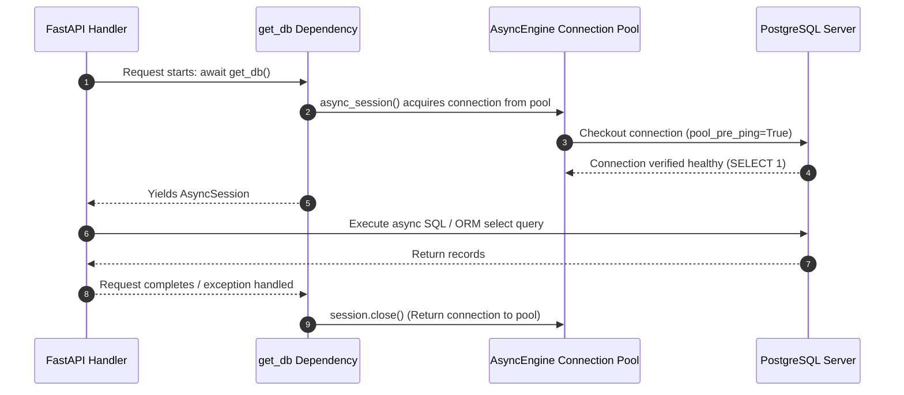

# 5. Database Analysis and Design

This document details the database architecture, schema definitions, spatial extensions, constraints, and data access layer for the MatsyaAI Maharashtra platform.

---

## 5.1 Database Technology Overview

- **RDBMS Engine:** PostgreSQL 16 (Container image: `postgis/postgis:16-3.4`)
- **Spatial Extension:** PostGIS 3.4
- **ORM / Data Access Layer:** SQLAlchemy 2.0.35 with AsyncIO extension (`sqlalchemy.ext.asyncio`)
- **Driver:** AsyncPG 0.29.0 (High-performance binary async driver)
- **Spatial ORM Bridge:** GeoAlchemy2 0.15.2
- **Migration Framework:** Alembic 1.13.3
- **Spatial Reference System (SRID):** `4326` (WGS-84 Geographic Coordinate System)

---

## 5.2 Entity-Relationship (ER) Diagram

```mermaid
erDiagram
    landing_centres ||--o{ incois_pfz_advisories : "geodesic origin"
    spatial_grids ||--o{ model_features : "aggregates"
    spatial_grids ||--o{ predictions : "projects onto"

    landing_centres {
        int id PK "auto-increment"
        varchar(255) name "e.g. Sassoon Dock"
        enum district "Palghar, Mumbai, Raigad, Ratnagiri, Sindhudurg"
        float latitude
        float longitude
        geometry geom "POINT, SRID 4326"
        varchar(255) source "MOCK_DEVELOPMENT_DATA / OFFICIAL"
        timestamptz created_at "UTC"
    }

    incois_pfz_advisories {
        int id PK "auto-increment"
        varchar(50) source "INCOIS"
        varchar(50) source_type "OFFICIAL_PFZ_ADVISORY"
        varchar(50) sector "Maharashtra"
        varchar(100) landing_centre
        varchar(20) direction
        int bearing_degrees
        varchar(50) distance_km
        int depth_min_m
        int depth_max_m
        float latitude
        float longitude
        geometry geom "POINT, SRID 4326"
        timestamptz advisory_date
        timestamptz validity_date
        timestamptz retrieved_at
        varchar(255) source_url
        varchar(64) hash_id UK "SHA-256 Batch Hash"
    }

    pfz_zones {
        int id PK "auto-increment"
        date date
        float latitude
        float longitude
        geometry geom "GEOMETRY, SRID 4326"
        float depth
        varchar(255) source_name "INCOIS"
        varchar(255) dataset_name "OFFICIAL_PFZ_ADVISORY"
        timestamptz source_timestamp
        timestamptz retrieved_at
        varchar(100) spatial_resolution
        varchar(100) temporal_resolution
        varchar(50) data_quality_status
        boolean is_stale
    }

    marine_warnings {
        int id PK "auto-increment"
        varchar(255) warning_type "COASTAL_FISHERMEN_WARNING"
        varchar(100) severity "NORMAL, WARNING, SEVERE"
        timestamptz valid_from
        timestamptz valid_until
        text description
        geometry geom "GEOMETRY, SRID 4326"
        varchar(255) source_name "IMD_MUMBAI_FISHERMAN_BULLETIN"
        varchar(255) dataset_name
        timestamptz source_timestamp
        timestamptz retrieved_at
        varchar(100) spatial_resolution
        varchar(100) temporal_resolution
        varchar(50) data_quality_status
        boolean is_stale
    }

    ocean_observations {
        int id PK "auto-increment"
        timestamptz timestamp "Observation / valid time"
        float latitude
        float longitude
        geometry geom "POINT, SRID 4326"
        float sst
        float sst_anomaly
        float chlorophyll
        float wind_speed
        float wind_direction
        float wave_height
        float wave_period
        float swell_height
        float current_speed
        float current_direction
        varchar(255) source_name "Open-Meteo / CMEMS"
        varchar(255) dataset_name
        timestamptz source_publication_time "Anti-leakage control"
        timestamptz retrieved_at
        varchar(100) spatial_resolution
        varchar(100) temporal_resolution
        varchar(50) data_quality_status
        boolean is_stale
    }

    gfw_fishing_effort {
        int id PK "auto-increment"
        varchar(100) grid_cell_id "INDEXED"
        float latitude
        float longitude
        timestamptz observation_date "INDEXED"
        timestamptz retrieved_at
        float fishing_hours
        varchar(100) vessel_type
        varchar(100) geartype
        varchar(10) flag
        varchar(64) hash_id UK "Unique Content Hash"
    }

    spatial_grids {
        varchar(100) id PK "e.g. cell_19.0_72.8"
        float resolution "0.25 deg"
        float latitude
        float longitude
        geometry geom "POLYGON, SRID 4326"
        geometry centroid "POINT, SRID 4326"
        float distance_to_coast_km
    }

    model_features {
        int id PK "auto-increment"
        varchar(100) grid_cell_id FK
        timestamptz timestamp
        float wave_height
        float wave_period
        float wave_direction
        float wind_speed
        float wind_direction
        float sst
        int hour
        int day_of_year
        varchar(50) season
        boolean is_valid
        varchar(255) provenance
        varchar(255) imputation_flags
    }

    predictions {
        int id PK "auto-increment"
        timestamptz prediction_timestamp
        float latitude
        float longitude
        geometry geom "POINT, SRID 4326"
        float prediction_probability
        int prediction_class
        varchar(200) prediction_label
        varchar(100) model_version
        varchar(100) model_trained_at
        timestamptz env_observation_timestamp
        varchar(100) env_source
        float data_freshness_seconds
        varchar(100) safety_status
        boolean safety_override
        text pfz_advisory
        timestamptz created_at
    }
```

---

## 5.3 Detailed Table Schemas

### 1. `landing_centres`
Stores coastal landing centres, fishing harbours, and major fish landing jetties across Maharashtra.
- **Model File:** `backend/app/models/landing_centre.py`
- **Columns:**
  - `id` (INTEGER, Primary Key, Autoincrement)
  - `name` (VARCHAR(255), NOT NULL): Official name of landing centre (e.g., "Sassoon Dock", "Mirkarwada").
  - `district` (ENUM `DistrictEnum`, NOT NULL): One of `Palghar`, `Mumbai`, `Raigad`, `Ratnagiri`, `Sindhudurg`.
  - `latitude` (FLOAT, NOT NULL): WGS-84 latitude.
  - `longitude` (FLOAT, NOT NULL): WGS-84 longitude.
  - `geom` (GEOMETRY(POINT, 4326), NOT NULL): PostGIS spatial point.
  - `source` (VARCHAR(255), NOT NULL): Ingestion origin.
  - `created_at` (TIMESTAMPTZ, Default: `NOW()` UTC).

---

### 2. `incois_pfz_advisories`
Stores Potential Fishing Zone advisory records extracted from the official INCOIS TextData portal.
- **Model File:** `backend/app/models/incois_pfz.py`
- **Columns:**
  - `id` (INTEGER, Primary Key, Autoincrement)
  - `source` (VARCHAR(50), NOT NULL, Default: `"INCOIS"`).
  - `source_type` (VARCHAR(50), NOT NULL, Default: `"OFFICIAL_PFZ_ADVISORY"`).
  - `sector` (VARCHAR(50), NOT NULL, Default: `"Maharashtra"`).
  - `landing_centre` (VARCHAR(100), NOT NULL): Reference port (e.g., "Talashil", "Arnala").
  - `direction` (VARCHAR(20), NOT NULL): Compass bearing string (e.g., "SW", "WNW").
  - `bearing_degrees` (INTEGER, NOT NULL): Bearing angle $[0^\circ, 360^\circ]$.
  - `distance_km` (VARCHAR(50), NOT NULL): Distance from origin port.
  - `depth_min_m` (INTEGER, Nullable): Shallowest depth contour in metres.
  - `depth_max_m` (INTEGER, Nullable): Deepest depth contour in metres.
  - `latitude` (FLOAT, NOT NULL): Converted decimal latitude.
  - `longitude` (FLOAT, NOT NULL): Converted decimal longitude.
  - `geom` (GEOMETRY(POINT, 4326), NOT NULL): Spatial location point.
  - `advisory_date` (TIMESTAMPTZ, Nullable): Extracted bulletin date.
  - `validity_date` (TIMESTAMPTZ, Nullable): Expiry timestamp (set to 23:59:59 UTC).
  - `retrieved_at` (TIMESTAMPTZ, NOT NULL): Exact download timestamp.
  - `source_url` (VARCHAR(255), NOT NULL).
  - `hash_id` (VARCHAR(64), UNIQUE, INDEXED, NOT NULL): SHA-256 batch deduplication hash.

---

### 3. `marine_warnings`
Stores meteorological marine weather and cyclone warnings parsed from IMD Mumbai bulletins.
- **Model File:** `backend/app/models/marine_warning.py`
- **Columns:**
  - `id` (INTEGER, Primary Key, Autoincrement)
  - `warning_type` (VARCHAR(255), NOT NULL): e.g., `"COASTAL_FISHERMEN_WARNING"`, `"HIGH_SEA_WIND_WARNING"`, `"HIGH_WAVE_WARNING"`.
  - `severity` (VARCHAR(100), NOT NULL): `"NORMAL"`, `"WARNING"`, or `"SEVERE"`.
  - `valid_from` (TIMESTAMPTZ, NOT NULL): Start of validity window.
  - `valid_until` (TIMESTAMPTZ, NOT NULL): End of validity window.
  - `description` (TEXT, NOT NULL): Raw warning text.
  - `geom` (GEOMETRY, 4326, NOT NULL): PostGIS spatial polygon bounding the warning zone.
  - `source_name` (VARCHAR(255), NOT NULL, Default: `"IMD_MUMBAI_FISHERMAN_BULLETIN"`).
  - `dataset_name` (VARCHAR(255), NOT NULL).
  - `source_timestamp` (TIMESTAMPTZ, NOT NULL): Official issue timestamp.
  - `retrieved_at` (TIMESTAMPTZ, NOT NULL): Download timestamp.
  - `spatial_resolution` (VARCHAR(100), Nullable).
  - `temporal_resolution` (VARCHAR(100), Nullable).
  - `data_quality_status` (VARCHAR(50), NOT NULL, Default: `"VALID"`).
  - `is_stale` (BOOLEAN, NOT NULL, Default: `False`).

---

### 4. `predictions`
Stores batch-executed machine learning predictions for the 0.25° Maharashtra marine grid.
- **Model File:** `backend/app/models/prediction.py`
- **Columns:**
  - `id` (INTEGER, Primary Key, Autoincrement)
  - `prediction_timestamp` (TIMESTAMPTZ, NOT NULL): Time the batch inference was executed.
  - `latitude` (FLOAT, NOT NULL): Grid centroid latitude.
  - `longitude` (FLOAT, NOT NULL): Grid centroid longitude.
  - `geom` (GEOMETRY(POINT, 4326), NOT NULL): Centroid geometry.
  - `prediction_probability` (FLOAT, NOT NULL): XGBoost probability $\in [0.0, 1.0]$.
  - `prediction_class` (INTEGER, NOT NULL): Binary classification ($0$ or $1$).
  - `prediction_label` (VARCHAR(200), NOT NULL): `"High Apparent Fishing Effort"` or `"Low/No Apparent Fishing Effort"`.
  - `model_version` (VARCHAR(100), NOT NULL, Default: `"Phase3_XGBoost_v1"`).
  - `model_trained_at` (VARCHAR(100), NOT NULL).
  - `env_observation_timestamp` (TIMESTAMPTZ, NOT NULL): Timestamp of environmental data used.
  - `env_source` (VARCHAR(100), NOT NULL): e.g., `"Open-Meteo"`.
  - `data_freshness_seconds` (FLOAT, NOT NULL): Latency of environmental input.
  - `safety_status` (VARCHAR(100), NOT NULL): `"SAFE_CONFIRMED"`, `"CAUTION"`, `"UNSAFE"`, or `"NO_WARNING_DATA"`.
  - `safety_override` (BOOLEAN, NOT NULL, Default: `False`): `True` if high prediction was overridden by active severe warning.
  - `pfz_advisory` (TEXT, Nullable).
  - `created_at` (TIMESTAMPTZ, Default: `NOW()` UTC).

---

### 5. `spatial_grids`
Represents the canonical marine spatial grid cells covering Maharashtra waters.
- **Model File:** `backend/app/models/feature.py`
- **Columns:**
  - `id` (VARCHAR(100), Primary Key): e.g., `"cell_19.00_72.75_0.25"`.
  - `resolution` (FLOAT, NOT NULL): Step resolution in degrees (`0.25`).
  - `latitude` (FLOAT, NOT NULL): Centroid latitude.
  - `longitude` (FLOAT, NOT NULL): Centroid longitude.
  - `geom` (GEOMETRY(POLYGON, 4326), NOT NULL): Exact bounding polygon.
  - `centroid` (GEOMETRY(POINT, 4326), NOT NULL): Spatial centroid.
  - `distance_to_coast_km` (FLOAT, Nullable): Shortest Haversine distance to coast.

---

### 6. `gfw_fishing_effort`
Stores historical and ingested apparent fishing effort from Global Fishing Watch AIS tracking.
- **Model File:** `backend/app/models/gfw.py`
- **Columns:**
  - `id` (INTEGER, Primary Key, Autoincrement)
  - `grid_cell_id` (VARCHAR(100), INDEXED, Nullable).
  - `latitude` (FLOAT, NOT NULL).
  - `longitude` (FLOAT, NOT NULL).
  - `observation_date` (TIMESTAMPTZ, INDEXED, NOT NULL): Calendar date fishing occurred.
  - `retrieved_at` (TIMESTAMPTZ, NOT NULL).
  - `fishing_hours` (FLOAT, NOT NULL): Apparent fishing effort in hours.
  - `vessel_type` (VARCHAR(100), Nullable).
  - `geartype` (VARCHAR(100), Nullable).
  - `flag` (VARCHAR(10), Nullable): Country flag (e.g., `"IND"`).
  - `hash_id` (VARCHAR(64), UNIQUE, NOT NULL): Deduplication content hash.

---

## 5.4 Database Migration History (Alembic)

The database schema evolution is tracked in `backend/alembic/versions/`:

| Revision ID | Name / Description | Key Schema Modifications |
| :--- | :--- | :--- |
| `01d27f92e854` | `initial_schema.py` | Creates PostGIS extension, `landing_centres`, `ocean_observations`, `pfz_zones`, and `marine_warnings` tables with basic spatial columns. |
| `3799bc745018` | `add_provenance_and_quality_fields.py` | Adds `spatial_resolution`, `temporal_resolution`, `data_quality_status`, `is_stale`, and `retrieved_at` metadata fields to guarantee data provenance. |
| `c75009cfc94b` | `add_feature_engineering_models.py` | Introduces `spatial_grids` and `model_features` tables supporting canonical ML feature engineering. |
| `ef789012gh34` | `add_gfw_model_and_rename_ocean_.py` | Creates `gfw_fishing_effort` table with `hash_id` uniqueness and indexes; renames ocean observation timestamps to `source_publication_time` to eliminate temporal leakage. |
| `abcd1234ef56` | `add_incois_pfz_advisory.py` | Adds dedicated `incois_pfz_advisories` table with `hash_id` index for official web table scraping. |
| `8596d05bae1b` | `update_predictions_schema_for_phase5.py` | Migrates `predictions` table schema to support Phase 4/5 outputs: `prediction_probability`, `model_version`, `env_source`, and decoupled `safety_status`. |

---

## 5.5 Data Access Lifecycle & Async Connection Pooling

- **Connection Pool Configuration (`backend/app/core/database.py`):**
  - `pool_size = 5`
  - `max_overflow = 10`
  - `pool_pre_ping = True` (automatically detects and drops severed database sockets)
  - `expire_on_commit = False` (prevents unnecessary re-querying of attributes on committed instances).
