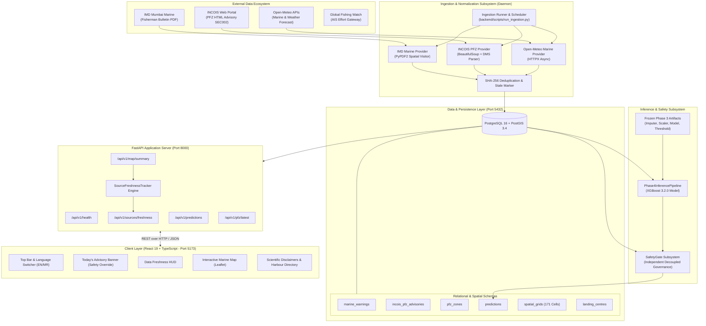
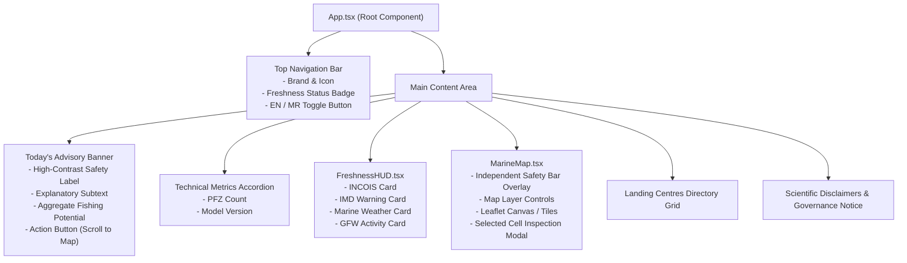
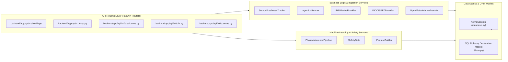
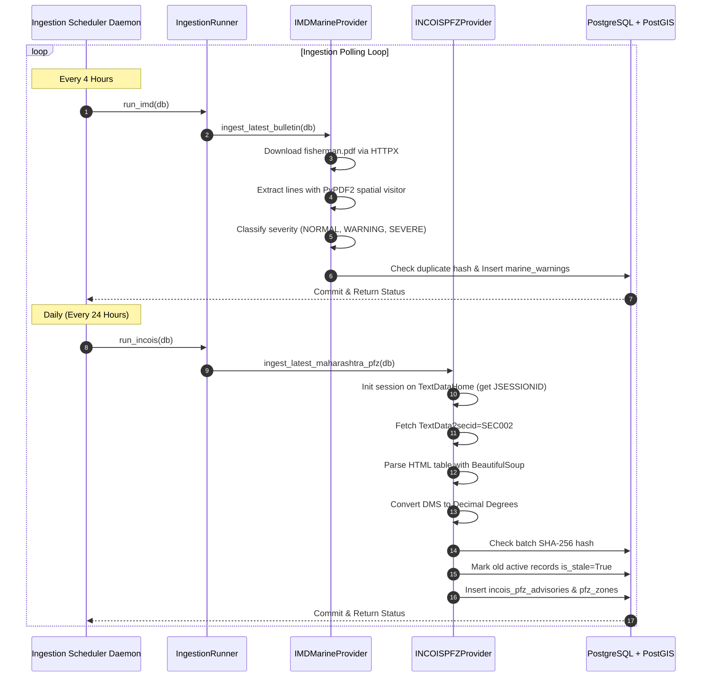
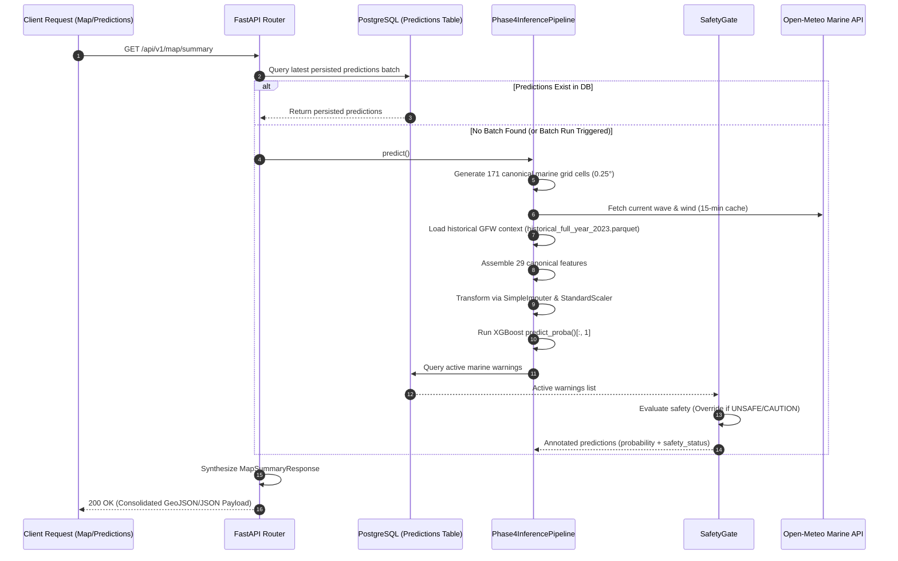
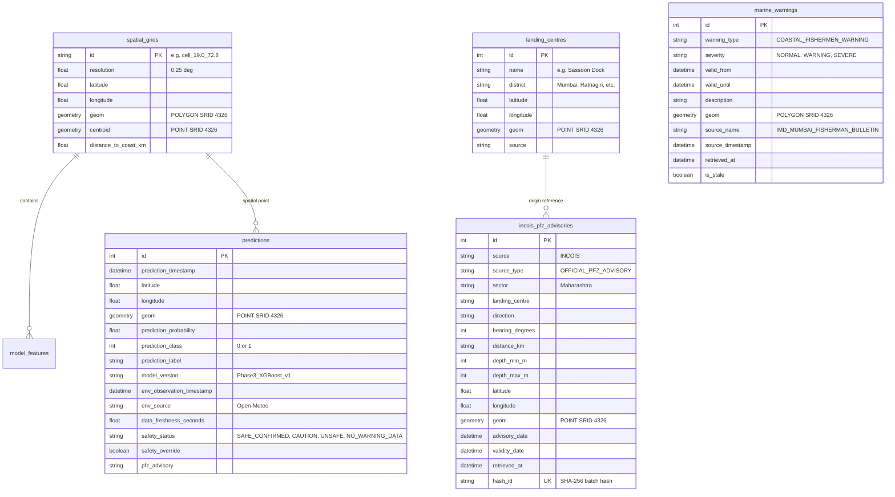

# 3. System Architecture

## 3.1 High-Level Architecture Overview

MatsyaAI Maharashtra is architected as a decoupled, multi-tier, micro-service platform designed for high fault tolerance, geospatial computing, and independent safety governance.

---

## 3.2 Frontend Architecture

The frontend is a single-page application (SPA) built on **React 19**, **TypeScript**, and **Leaflet**, compiled via **Vite**.

### Component Hierarchy

### Key Architectural Characteristics of Frontend:
1. **Unidirectional State Flow:** Root state (`mapData`, `health`, `isMarathi`, `isDemo`, `loading`, `error`) resides in `App.tsx` and cascades down via typed props.
2. **Periodic Polling Synchronization:** An automated 60-second polling interval re-executes `fetchMapSummary()` in the background to ensure fishermen see the latest weather alerts and advisory updates.
3. **Decoupled Safety Presentation:** The frontend explicitly checks `marine_safety.overall_status`. The state `NO_WARNING_DATA` is styled using neutral dark slate-grey (`#37474f` / `#90a4ae`) and is **never** permitted to render green or convey a safe condition.
4. **Resilient Offline/Demo Fallback:** If the live backend or network fails, an error alert provides a single-click fallback to load real cached demonstration data.

---

## 3.3 Backend Architecture

The backend is built on **FastAPI** following a layered architecture that cleanly separates routing, business services, machine learning inference, and data persistence:

### Module Responsibilities:
- **`app/api/v1/`:** Pure request deserialization, dependency injection (`Depends(get_db)`), and response serialization via Pydantic.
- **`app/core/`:** Centralized settings singleton (`Settings`), async engine pool management, and structured logging.
- **`app/services/freshness/`:** Real-time source freshness evaluation calculated from true observation dates rather than database retrieval timestamps.
- **`app/services/ingestion/`:** Modular, isolated extract-transform-load (ETL) providers adhering to `BaseProvider`.
- **`app/ml/`:** Model artifact deserialization, 171-cell spatial grid generation, 29-feature alignment, XGBoost inference, and safety gate application.

---

## 3.4 Ingestion Pipeline & Daemon Architecture

The background ingestion worker (`backend/scripts/run_ingestion.py --daemon`) runs asynchronously alongside the web server:

---

## 3.5 ML Prediction & Safety Pipeline Architecture

---

## 3.6 Client-Server Communication & API Design

- **Transport:** Standard HTTP/1.1 over TCP (Docker internal network / localhost).
- **Format:** Strict JSON REST contracts validated by Pydantic.
- **CORS Policy:** Strict origin whitelisting configured via `Settings.CORS_ORIGINS` (`http://localhost:5173`, `http://localhost:3000`).
- **Proxy Configuration:** Vite dev-server intercepts all `/api/*` frontend calls and transparently proxies them to `http://backend:8000/api/*`, eliminating cross-origin preflight latency in development and containerized deployments.

---

## 3.7 Database Architecture & Spatial Capabilities

---

## 3.8 External Service Integration & Fallback Strategy

| Integration | Primary Ingestion Path | Failure Detection Mechanism | Fallback / Graceful Degradation Strategy |
| :--- | :--- | :--- | :--- |
| **IMD Marine Bulletin** | HTTPS fetch of `fisherman.pdf` from `mausam.imd.gov.in`. | HTTP 4xx/5xx status codes, PDF header validation failure, PyPDF2 extraction empty. | Retains previously stored warnings; marks them `is_stale=True` when expired. Safety gate yields `NO_WARNING_DATA`. **Never assumes calm/safe conditions.** |
| **INCOIS PFZ Feed** | HTTPS session init on `TextDataHome` + GET on `TextData?secid=SEC002`. | HTTP redirect to generic page, missing `JSESSIONID`, missing table in BeautifulSoup parse. | Retains last valid advisory records; marks old records `is_stale=True`. API returns `status="STALE"` with last known valid timestamps. In demo mode, falls back to documented historical reference coordinates. |
| **Open-Meteo Marine & Forecast** | REST API calls batched across 40 centroids with 15-minute in-memory caching. | Network timeout (10s), HTTP error, empty current weather payload. | Switches to `DEMO_MODE` environmental fallback, sourcing representative historical marine observations from `historical_full_year_2023.parquet`. |
| **Global Fishing Watch (GFW)** | GFW 4Wings Report API chunked by calendar month. | Missing `GFW_API_TOKEN`, HTTP 401/403, network unreachable. | Gracefully sets status to `UNAVAILABLE` or `CACHED_HISTORICAL`. Never fabricates vessel AIS effort. Zero AIS effort defaults to $0.0$ hours. |
