# 2. Technology Stack Analysis

This document provides a comprehensive audit of every technology, language, library, database, API, and tool employed across the MatsyaAI Maharashtra platform. All versions and paths are verified directly from repository configuration and lockfiles (`backend/requirements.txt`, `frontend/package.json`, `docker-compose.yml`, `.env.example`).

---

## 2.1 Technology Stack Matrix

```mermaid
flowchart LR
    subgraph Client["Frontend Client (Port 5173)"]
        React["React 19.2.8"]
        Leaflet["Leaflet 1.9.4"]
        TS["TypeScript ~6.0"]
        Vite["Vite 8.2.2"]
    end

    subgraph Server["Backend Server (Port 8000)"]
        FastAPI["FastAPI 0.115.0"]
        Uvicorn["Uvicorn 0.30.6"]
        SQLAlchemy["SQLAlchemy 2.0.35 (Async)"]
        GeoAlchemy["GeoAlchemy2 0.15.2"]
        Pydantic["Pydantic 2.9.2"]
        Structlog["Structlog 24.4.0"]
    end

    subgraph DataML["Machine Learning & Data Processing"]
        XGBoost["XGBoost 3.2.0"]
        Sklearn["Scikit-Learn 1.6.1"]
        Pandas["Pandas 2.2.3"]
        NumPy["NumPy 1.26.4"]
        PyArrow["PyArrow 15.0.2"]
        GlobalLand["Global-Land-Mask 1.0.0"]
        PyPDF2["PyPDF2 3.0.1"]
        BS4["BeautifulSoup4 4.12.3"]
    end

    subgraph Storage["Database & Persistence (Port 5432)"]
        Postgres["PostgreSQL 16"]
        PostGIS["PostGIS 3.4"]
        Parquet["Parquet Columnar Files"]
    end

    subgraph External["Authoritative External Providers"]
        INCOIS_EXT["INCOIS TextData (JSESSIONID)"]
        IMD_EXT["IMD Mumbai Bulletin (PDF)"]
        OpenMeteo_EXT["Open-Meteo Marine & Forecast API"]
        GFW_EXT["Global Fishing Watch 4Wings API"]
        CMEMS_EXT["Copernicus Marine (CMEMS)"]
    end

    Client --> Server
    Server --> Storage
    Server --> DataML
    Server --> External
```

---

## 2.2 Frontend Technologies

### 1. React
- **Version:** `19.2.8` (Verified in `frontend/package.json`)
- **Purpose:** Core UI library for component-based reactive rendering.
- **Where & How Used:**
  - `frontend/src/App.tsx`: Manages root application state, language selection, polling timers, and metric aggregation.
  - `frontend/src/components/FreshnessHUD.tsx`: Renders real-time data freshness cards for each ingestion feed.
- **Why Relevant:** Provides high-speed virtual DOM reconciliation, allowing seamless updates when real-time marine weather or safety advisories refresh without triggering disruptive full-page reloads.

### 2. Leaflet & @types/leaflet
- **Version:** `leaflet ^1.9.4`, `@types/leaflet ^1.9.22`
- **Purpose:** High-performance, lightweight, mobile-friendly interactive mapping engine.
- **Where & How Used:**
  - `frontend/src/map/MarineMap.tsx`: Constructs the map instance (center: `[17.85, 72.85]`, zoom: 7), renders 0.25° canonical prediction grid bounding boxes (`L.rectangle`), INCOIS PFZ target circles with 4 km buffer rings (`L.circleMarker`, `L.circle`), and harbour markers (`L.divIcon`).
- **Why Relevant:** Leaflet is significantly lighter than MapLibre/Mapbox GL for low-end mobile devices common in coastal Maharashtra villages, requiring no WebGL hardware acceleration dependencies while effortlessly handling hundreds of dynamic polygon overlays.

### 3. Vite & @vitejs/plugin-react
- **Version:** `vite ^8.2.2`, `@vitejs/plugin-react ^6.1.0`
- **Purpose:** Frontend build tool, development server, and reverse proxy bundler.
- **Where & How Used:**
  - `frontend/vite.config.ts`: Configures Vite plugins and dev-server proxy rules (`/api` routed to backend container at `http://backend:8000`).
- **Why Relevant:** Instant hot-module replacement (HMR) and optimized Rollup tree-shaken production builds completed in under 250 milliseconds.

### 4. TypeScript
- **Version:** `~6.0.2` (Verified in `frontend/package.json`)
- **Purpose:** Static type enforcement across the frontend codebase.
- **Where & How Used:**
  - `frontend/src/types/map.ts`: Enforces strict data models for `CellPrediction`, `SafetyStatus`, `MapSummaryResponse`, `SourceFreshness`, and `PredictionProvenance`.
  - `frontend/src/types/health.ts`: Enforces backend health response contracts.
- **Why Relevant:** Prevents runtime `TypeError` issues when processing deeply nested backend geo-payloads and multilingual dictionaries.

---

## 2.3 Backend Technologies

### 1. FastAPI
- **Version:** `0.115.0` (Verified in `backend/requirements.txt`)
- **Purpose:** Modern, asynchronous, high-concurrency web framework for Python.
- **Where & How Used:**
  - `backend/app/main.py`: Creates application instance, mounts lifespan handlers, enables CORS, and includes API routers.
  - `backend/app/api/v1/`: Implements REST endpoints (`health.py`, `map.py`, `predictions.py`, `pfz.py`, `sources.py`).
- **Why Relevant:** Fully native ASGI asynchronous request handling allows the backend to perform external HTTP polling and concurrent database queries without thread-blocking. Automatically generates OpenAPI/Swagger schemas at `/docs`.

### 2. Uvicorn[standard]
- **Version:** `0.30.6`
- **Purpose:** High-performance ASGI web server powered by `uvloop` and `httptools`.
- **Where & How Used:**
  - `docker/backend.Dockerfile`: Entrypoint command running `uvicorn backend.app.main:app --host 0.0.0.0 --port 8000 --reload`.
- **Why Relevant:** Industry standard for serving async Python web applications with low latency and high request throughput.

### 3. Pydantic & Pydantic-Settings
- **Version:** `pydantic==2.9.2`, `pydantic-settings==2.5.2`
- **Purpose:** Data validation, strict type enforcement, and environment variable parsing.
- **Where & How Used:**
  - `backend/app/core/config.py`: Implements `Settings` class inheriting `BaseSettings`, loading configuration from `.env`.
  - `backend/app/schemas/pfz.py`: Defines request/response models (`PFZLocation`, `PFZLatestResponse`).
  - `backend/app/api/v1/health.py`: Defines `HealthResponse`.
- **Why Relevant:** Guarantees that invalid external configurations or corrupted API payloads fail fast with explicit validation errors rather than silently propagating invalid data.

### 4. Structlog & Logging
- **Version:** `structlog==24.4.0`
- **Purpose:** Structured JSON logging for production observability.
- **Where & How Used:**
  - `backend/app/core/logging.py`: Configures structured context logging.
  - `backend/app/main.py`: Logs application lifecycle events (`application_startup`, `application_shutdown`).
- **Why Relevant:** Structured key-value logs can be effortlessly ingested and parsed by log aggregators (Elasticsearch, CloudWatch, Loki) in production.

---

## 2.4 Programming Languages

1. **Python:**
   - **Version:** `3.12` (Container base: `python:3.12-slim`, local: `3.12.4`)
   - **Usage:** Backend API, database ORM models, data ingestion daemons, web scraping, and machine learning pipeline.
   - **Rationale:** Mature ecosystem for scientific computing, geospatial processing, machine learning (XGBoost, Scikit-learn), and modern asynchronous web services.

2. **TypeScript / JavaScript:**
   - **Version:** TypeScript `~6.0.2`, JavaScript ECMAScript 2022+
   - **Usage:** Complete frontend client application (`frontend/src/`).
   - **Rationale:** Industry standard for robust, responsive single-page applications with compile-time type safety.

3. **SQL & Procedural SQL:**
   - **Version:** PostgreSQL 16 dialect with PostGIS spatial extensions.
   - **Usage:** Database schemas, spatial indexes, spatial queries (`ST_Distance`, `ST_Point`), and Alembic migrations.
   - **Rationale:** Standard language for relational data integrity and geospatial analysis.

---

## 2.5 Database & Storage Technologies

### 1. PostgreSQL
- **Version:** `16` (Image: `postgis/postgis:16-3.4` in `docker-compose.yml`)
- **Purpose:** Primary relational database management system.
- **Where & How Used:**
  - Stores all persistent entities: landing centres, advisories, marine warnings, predictions, and model features.
- **Why Relevant:** ACID compliance, excellent performance under concurrent read/write workloads, and native enterprise-grade support for complex spatial data.

### 2. PostGIS Extension
- **Version:** `3.4`
- **Purpose:** Spatial database extender for PostgreSQL.
- **Where & How Used:**
  - `backend/alembic/versions/01d27f92e854_initial_schema.py`: Enables PostGIS extension (`CREATE EXTENSION IF NOT EXISTS postgis`).
  - `backend/app/models/`: Geometry columns (`Geometry(geometry_type='POINT', srid=4326)` and `Geometry(geometry_type='POLYGON', srid=4326)`).
- **Why Relevant:** Enables spherical distance calculations, spatial indexing (R-Tree / GiST), and polygon intersection checks directly within database queries without loading massive point sets into Python memory.

### 3. SQLAlchemy (Asyncio) & Asyncpg
- **Version:** `sqlalchemy[asyncio]==2.0.35`, `asyncpg==0.29.0`
- **Purpose:** High-performance asynchronous Object Relational Mapper (ORM) and async PostgreSQL database driver.
- **Where & How Used:**
  - `backend/app/core/database.py`: Instantiates `create_async_engine` and `async_sessionmaker`.
  - `backend/app/models/`: Declares mapped ORM entities subclassing `Base`.
- **Why Relevant:** `asyncpg` is the fastest available PostgreSQL driver for Python, executing non-blocking database queries within the FastAPI event loop.

### 4. GeoAlchemy2
- **Version:** `0.15.2`
- **Purpose:** Bridges SQLAlchemy ORM with PostGIS spatial types and functions.
- **Where & How Used:**
  - `backend/app/models/`: Imports and maps `Geometry` column types across `landing_centre.py`, `incois_pfz.py`, `marine_warning.py`, and `prediction.py`.
- **Why Relevant:** Allows transparent handling of Well-Known Text (WKT) and Well-Known Binary (WKB) geometric representations directly within Python ORM instances.

### 5. Alembic
- **Version:** `1.13.3`
- **Purpose:** Database migration tool for SQLAlchemy.
- **Where & How Used:**
  - `backend/alembic/`: Contains migration environment (`env.py`) and version scripts tracking schema revisions from initial setup to Phase 5.
- **Why Relevant:** Provides deterministic, version-controlled database schema evolution that can be safely rolled forward or backward across environments.

### 6. Apache Parquet & PyArrow
- **Version:** `pyarrow==15.0.2`
- **Purpose:** High-efficiency columnar file storage format.
- **Where & How Used:**
  - `backend/app/ml/data/historical_full_year_2023.parquet`: Stores 59,850 observations of historical GFW effort and environmental records.
- **Why Relevant:** Columnar storage reduces disk usage by over 80% compared to raw CSV/JSON and allows sub-second scan and load times during ML training and historical caching.

---

## 2.6 Machine Learning & Data Processing Libraries

### 1. XGBoost
- **Version:** `3.2.0` (Verified in `backend/requirements.txt`)
- **Purpose:** Gradient boosted decision tree framework.
- **Where & How Used:**
  - `ml/training/experiment_phase3.py`: Trains the canonical Phase 3 classifier.
  - `backend/app/ml/artifacts/phase3_xgboost_model.joblib`: Serialized model evaluated during inference in `backend/app/ml/inference.py`.
- **Why Relevant:** State-of-the-art performance on tabular geospatial and environmental features; handles nonlinear feature interactions, missing data indicators, and provides superior Precision-Recall AUC on imbalanced targets.

### 2. Scikit-Learn
- **Version:** `1.6.1`
- **Purpose:** Machine learning preprocessing, scaling, baseline modeling, and evaluation metrics.
- **Where & How Used:**
  - `SimpleImputer` (median strategy) and `StandardScaler` serialized in `backend/app/ml/artifacts/`.
  - `ml/models/baselines.py`: Implements baseline benchmarks (Ridge regression, Logistic Regression, Random Forest).
  - Metric computation: `precision_recall_curve`, `roc_auc_score`, `f1_score`, `average_precision_score`.
- **Why Relevant:** Industry standard for reliable, mathematically sound tabular preprocessing and evaluation.

### 3. Pandas & NumPy
- **Version:** `pandas==2.2.3`, `numpy==1.26.4`
- **Purpose:** Data manipulation, vector math, rolling windows, and tabular aggregation.
- **Where & How Used:**
  - `ml/features/causal_dataset.py`: Builds causal training datasets using group-by operations and temporal lag shifts.
  - `backend/app/ml/dataset_builder.py`: Regrids observations and merges spatial coordinates.
- **Why Relevant:** Vectorized performance for calculating multi-day trailing means, standard deviations, and trigonometry (sine/cosine day of year transformations).

### 4. Global-Land-Mask
- **Version:** `1.0.0`
- **Purpose:** High-speed, numpy-based spatial checking for ocean vs. land coordinates.
- **Where & How Used:**
  - `backend/scripts/generate_spatial_grid.py`: Verifies coordinates with `globe.is_land(lat, lon)` to generate canonical marine cells.
  - `backend/app/ml/inference.py`: Uses `globe.is_ocean` across centroid and corner coordinates to retain only marine grid cells.
- **Why Relevant:** Extremely fast point-in-polygon land mask checking without requiring external GIS servers or heavy GDAL/Shapely dependencies.

### 5. Joblib
- **Version:** `1.4.2`
- **Purpose:** Optimized object serialization for scikit-learn and XGBoost pipelines.
- **Where & How Used:**
  - `ml/models/serialize_phase3_artifacts.py`: Serializes trained models, scalers, and imputers.
  - `backend/app/ml/inference.py`: Deserializes model artifacts during startup.
- **Why Relevant:** Optimized for preserving large NumPy arrays and model trees with zero precision loss.

---

## 2.7 Scraping & Document Ingestion Tools

### 1. BeautifulSoup4
- **Version:** `4.12.3`
- **Purpose:** HTML parsing and web scraping.
- **Where & How Used:**
  - `backend/app/services/ingestion/incois_pfz_provider.py`: Parses raw HTML from INCOIS `TextData?secid=SEC002`, extracts table rows, headers, and date stamps.
- **Why Relevant:** Resilient against poorly formatted government HTML tables, missing closing tags, and inline formatting artifacts.

### 2. PyPDF2
- **Version:** `3.0.1`
- **Purpose:** Spatial text extraction from PDF documents.
- **Where & How Used:**
  - `backend/app/services/ingestion/imd_marine_provider.py`: Extracts raw text lines using spatial visitor callbacks (`visitor_text`) to sort text chunks top-to-bottom and left-to-right, solving font kerning separation issues.
- **Why Relevant:** Pure Python PDF parser requiring no heavy external C libraries like `poppler` or `pdf2image`.

### 3. HTTPX
- **Version:** `0.27.2`
- **Purpose:** Modern asynchronous HTTP client for Python.
- **Where & How Used:**
  - `backend/app/services/ingestion/incois_pfz_provider.py`: Handles HTTP requests with cookies (`JSESSIONID`) and redirection management.
  - `backend/app/services/ingestion/imd_marine_provider.py`: Downloads PDF bulletins with retry backoffs.
  - `backend/tests/`: Used as FastAPI async test client.
- **Why Relevant:** Native async/await support, connection pooling, and seamless SSL configuration.

---

## 2.8 Third-Party APIs & External Integrations

| External Service | Endpoint / Resource | Format | Access Mode | Purpose |
| :--- | :--- | :--- | :--- | :--- |
| **INCOIS TextData System** | `https://incois.gov.in/MarineFisheries/TextData?secid=SEC002` | HTML Table | Public (Requires `JSESSIONID` from `TextDataHome`) | Ingests official Potential Fishing Zone advisories for Maharashtra coast. |
| **IMD Mumbai Marine** | `https://mausam.imd.gov.in/mumbai/mcdata/fisherman.pdf` | PDF Document | Public HTTPS | Ingests daily Fishermen Warning Bulletins (squalls, rough sea, gale warnings). |
| **Open-Meteo Marine API** | `https://marine-api.open-meteo.com/v1/marine` | JSON | Public REST (Rate-limited, cached) | Fetches live wave height, wave period, wave direction, and swell height. |
| **Open-Meteo Forecast API** | `https://api.open-meteo.com/v1/forecast` | JSON | Public REST | Fetches live 10 m wind speed across grid cell centroids. |
| **Global Fishing Watch (GFW)** | `https://gateway.api.globalfishingwatch.org/v3/4wings/report` | JSON | Authenticated (`Bearer GFW_API_TOKEN`) | Captures historical apparent fishing vessel activity from AIS transmissions. |
| **Copernicus Marine (CMEMS)** | `cmems_mod_glo_phy_anfc_0.083deg_P1D-m` | NetCDF / REST | Authenticated (User/Password) | Ocean physics and biogeochemical evaluation (evaluated for future scale-up). |
| **OpenStreetMap** | `https://tile.openstreetmap.org/{z}/{x}/{y}.png` | PNG Raster Tiles | Public | Cartographic base tiles for the interactive Leaflet map. |

---

## 2.9 Containerization, Deployment & CI/CD

### 1. Docker & Docker Compose
- **Versions:** Docker Engine v24+, Docker Compose v2+
- **Configuration:** `docker-compose.yml` declaring 4 coordinated services:
  1. `db`: `postgis/postgis:16-3.4` (Postgres database with PostGIS extensions)
  2. `backend`: FastAPI backend running on Python 3.12 slim
  3. `ingestion`: Dedicated background daemon running `run_ingestion.py --daemon`
  4. `frontend`: Node.js 20 Alpine container running Vite dev/preview server
- **Networks & Volumes:**
  - Network: `matsya_net` (bridge driver)
  - Volume: `pgdata` (local driver for persistent PostgreSQL database storage)
- **Why Relevant:** Provides complete platform isolation and deterministic deployment reproducibility across development, staging, and production environments.

---

## 2.10 Testing & Quality Assurance Tooling

1. **Pytest & Pytest-Asyncio:**
   - **Version:** `pytest==8.3.3`, `pytest-asyncio==0.24.0`
   - **Usage:** Executes 15 test suites in `backend/tests/` covering database connections, safety gate rules, ingestion parsing, and ML inference.
2. **Vitest & Testing Library:**
   - **Version:** `vitest ^5.0.1`, `@testing-library/react ^16.3.3`, `@testing-library/jest-dom ^7.0.1`, `jsdom ^29.1.1`
   - **Usage:** Frontend unit and component testing (`frontend/src/App.test.tsx`).
3. **Oxlint:**
   - **Version:** `^1.79.0` (Verified in `frontend/package.json`)
   - **Usage:** Ultra-fast JavaScript/TypeScript linter for enforcing code quality.
