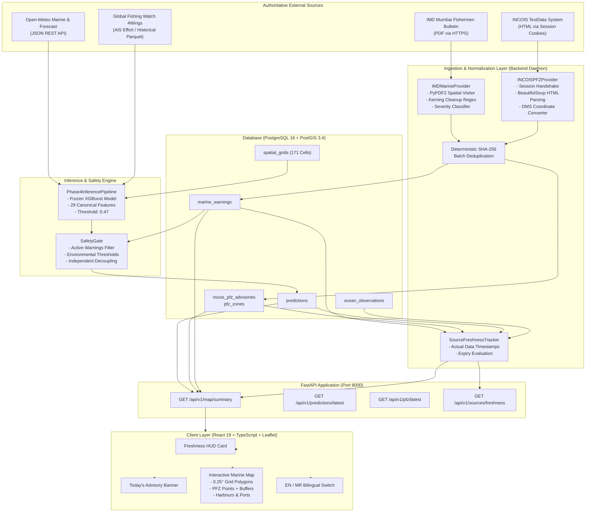

# 1. Project Overview

## 1.1 Project Identity & Purpose

**Project Name:** MatsyaAI Maharashtra  
**Domain:** Marine Decision Support, Fisheries Informatics, Geospatial Analytics, Causal Machine Learning  
**Geographic Scope:** Maharashtra Coast & Exclusive Economic Zone (EEZ), India (Lat: 15.50°N – 20.00°N, Lon: 72.00°E – 74.00°E)  
**Primary Mission:** To provide a fisherman-first, safety-decoupled decision support platform that empowers artisanal, motorized, and mechanized marine fishers along the Maharashtra coastline to answer three vital operational questions before every sailing:
1. **Can I safely go fishing today?** (Independent marine safety evaluation based on authoritative alerts and sea thresholds)
2. **Where are the most promising potential fishing grounds today?** (Synthesizing official INCOIS Potential Fishing Zones and predictive machine learning models of apparent vessel activity)
3. **How do I safely navigate from my home landing centre to these grounds?** (Geospatial bearing, distance in nautical kilometers, and district harbour context)

---

## 1.2 Problem Statement

Small-scale artisanal and commercial fishermen operating along Maharashtra's 720 km coastline face substantial economic, environmental, and physical safety hurdles:

1. **Fragmented, Unprocessed Authoritative Information:**
   - The **India Meteorological Department (IMD)** publishes marine cyclone and rough-sea warnings as formatted PDF bulletins (`fisherman.pdf`) that require manual reading, domain interpretation of meteorological terminology (e.g., "squally weather with wind speed 45-55 kmph gusting to 65 kmph"), and geographical spatialization.
   - The **Indian National Centre for Ocean Information Services (INCOIS)** generates Potential Fishing Zone (PFZ) advisories based on satellite Ocean Colour Monitor (OCM) chlorophyll-a fronts and Sea Surface Temperature (SST) thermal boundaries. However, these advisories are served as complex HTML tables requiring session cookies, expressed in Degrees-Minutes-Seconds (DMS) bearings from select ports, rendering them difficult to interpret on mobile devices in coastal villages.

2. **Dangerous Confusion Between "Fish Abundance" and "Sea Safety":**
   - High ocean productivity (e.g., thermal fronts and upwelling) frequently coincides with high winds, monsoonal squalls, and steep swells.
   - Conventional commercial tools often present "fish hot spots" without enforcing independent safety overrides, inducing fishermen into hazardous waters during monsoon transitions or cyclonic depressions.

3. **High Operational Fuel Costs & Economic Inefficiencies:**
   - Marine diesel accounts for 60% to 75% of fishing operational trip expenditure. Without targeted navigation vectors and ground-activity forecasts, boats search blindly across shelf waters, wasting hundreds of litres of fuel and increasing carbon emissions.

4. **Digital Divide & Language Barriers:**
   - The majority of Maharashtra's coastal fishing communities (across Palghar, Mumbai, Raigad, Ratnagiri, and Sindhudurg districts) speak Marathi as their primary language. Most scientific portals and GIS tools are published exclusively in technical English or require desktop GIS software.

5. **Data Staleness & Misleading "All-Clear" Signals:**
   - In distributed data systems, if an external source API fails or is unavailable, naive systems default to showing "No active warnings" — which fishers dangerously misinterpret as "Safe to sail".

---

## 1.3 Objectives & Intended Users

### Core Objectives
- **Zero-Harm Maritime Safety:** Decouple safety evaluation entirely from predictive ML algorithms. Ensure that no ML prediction can ever declare a marine zone "SAFE" without authoritative confirmation.
- **Unified Actionable Dashboard:** Ingest, parse, clean, and consolidate disparate government feeds (IMD, INCOIS, Open-Meteo) into a single visual dashboard.
- **Causal Machine Learning for Vessel Activity:** Predict next-calendar-day ($T+1$) apparent fishing effort using strict causal feature boundaries ($\le T$) to prevent data leakage and provide true forward predictive value.
- **Local Language Inclusivity:** Provide full bilingual support (English and Marathi / मराठी) with high-contrast, fisherman-optimized typography and responsive mobile viewports.
- **Complete Operational Transparency:** Expose exact data provenance, timestamp validity, and source health through an intuitive Freshness HUD.

### Intended User Personas

| Persona | Operational Context | Platform Value Delivered |
| :--- | :--- | :--- |
| **Artisanal Canoe / Small Craft Operator** | Operates non-motorized or small outboard motor (OBM) crafts within 5–15 km from shore; highly vulnerable to swells $>2.0$ m and wind $>35$ km/h. | Receives nearshore wave/wind warnings, immediate visual red/amber safety banners, and nearshore PFZ bearings from local landing centres. |
| **Mechanized Trawler / Purse-Seiner Skipper** | Operates 40–70 ft mechanized vessels with inboard engines operating 20–100 km offshore for 2–6 days. | Evaluates offshore 0.25° grid predictions, deep-water PFZ coordinates ($>50$ m depth), high-sea gale warnings, and optimizes fuel burn. |
| **Fisheries Cooperative Leader / Port Nakhawa** | Coordinates departure schedules for dozens of community boats from landing centres like Sassoon Dock, Mirkarwada, or Malvan. | Views statewide district-level overview, verifies source freshness, and issues community-wide advisory notices. |
| **Fisheries Department Official / Scientific Evaluator** | Audits platform operations, reviews model provenance, monitors seasonal monsoon resumption, and tracks data validity. | Accesses REST APIs (`/sources/freshness`, `/map/summary`), provenance metadata, and scientific evaluation reports. |

---

## 1.4 Core Features & Functionalities

1. **Fisherman-First Advisory Banner (Today's Advisory):**
   - Immediate top-level status indicator: `🚨 UNSAFE`, `⚠️ CAUTION`, `🛡️ SAFE CONFIRMED`, or `ℹ️ SAFETY DATA UNAVAILABLE`.
   - Explicit subtext explaining why a status is assigned, preventing dangerous assumptions when warning feeds are down.
   - Aggregate fishing potential metric displaying the count of high-activity cells.

2. **Official INCOIS PFZ Integration:**
   - Automated scraping and DMS parsing of daily advisories for Maharashtra sector (`SEC002`).
   - Renders official government zones on the map with custom green target markers and 4 km radius buffers.
   - Displays landing centre origin, bearing direction, distance in km, and depth contour ranges.

3. **Independent Multi-Tier Safety Gate:**
   - Independent verification against IMD Mumbai Fishermen Warning bulletins.
   - Application-level environmental threshold enforcement: Wave Height limit ($4.0$ m) and Wind Speed limit ($50$ km/h).
   - Strict rule: **Absence of warnings $\neq$ SAFE.** Yields `NO_WARNING_DATA` with slate-grey indicators if the warning feed is stale or unavailable.

4. **Phase 3 Causal Machine Learning Prediction Engine:**
   - Operationalizes an XGBoost classifier trained on full-year 2023 historical data (59,850 observations across 171 marine cells).
   - Predicts next-calendar-day ($T+1$) apparent fishing effort ($>1.0$ hours) using 29 canonical features.
   - Yields a PR-AUC of 0.4898 (+29.2% over best historical persistence baseline).

5. **Live Environmental Weather Ingestion:**
   - Automatically polls the Open-Meteo Marine and Forecast APIs across Maharashtra coastal grid centroids.
   - Ingests wave height, wave period, swell wave height, wave direction, and 10 m wind speed with 15-minute in-memory caching.

6. **Interactive Leaflet Marine Map:**
   - Built on Leaflet with OpenStreetMap tiles, customized for dark ocean aesthetics (`#071220`).
   - Canonical 0.25° grid overlay with dynamic cyan/blue color coding based on predicted probability.
   - Interactive cell inspection modal displaying distance to coast, coastal/offshore classification, environmental parameters, and disclaimer.
   - Layer toggles for Prediction Grid, INCOIS PFZ Advisories, and Coastal Landing Centres.

7. **Source Freshness & Data Health HUD:**
   - Visual heads-up display displaying real-time operational status (`LIVE`, `STALE`, `CACHED_HISTORICAL`, `UNAVAILABLE`) for INCOIS, IMD, Open-Meteo, and Global Fishing Watch.
   - Displays exact data age in minutes or days computed against actual observation/publication dates, never retrieval time alone.

8. **Bilingual Internationalization (EN / MR):**
   - Instant toggle between English and Marathi across all UI elements, labels, buttons, tooltips, and scientific disclaimers.

9. **Deterministic Ingestion & Deduplication Daemon:**
   - Background scheduling daemon (`backend/scripts/run_ingestion.py --daemon`) executing independent ingestion jobs.
   - SHA-256 batch deduplication ensuring idempotent execution.

10. **Demo Mode with Real Historical Fallbacks:**
    - Seamless fallback toggle enabling testing and demonstration without live network access, using verified historical 2023 cache data.

---

## 1.5 How the Complete Application Works: End-to-End Flow

---

## 1.6 Main Use Cases & Operational Workflows

### Use Case 1: Daily Pre-Sailing Safety Check (Morning Departure)
- **Actor:** Small-scale boat owner in Alibaug (Raigad).
- **Trigger:** Fishers prepare to venture into coastal waters at 05:00 IST.
- **Workflow:**
  1. Fisher opens MatsyaAI mobile browser interface.
  2. The system checks backend `/api/v1/map/summary`.
  3. The top banner immediately renders `🚨 UNSAFE` in high-contrast red if IMD has issued a coastal squall alert, or `⚠️ CAUTION` if offshore wave heights exceed 4.0 m.
  4. If authoritative bulletins confirm calm conditions, `🛡️ SAFE CONFIRMED` is displayed with green indicators.
  5. If the IMD portal was down and data is stale, the system renders `ℹ️ SAFETY DATA UNAVAILABLE` with slate-grey indicators, prompting the fisher to check local physical port signals.

### Use Case 2: Locating High-Probability Grounds & Navigating
- **Actor:** Mechanized trawler skipper at Mirkarwada (Ratnagiri).
- **Trigger:** Safe weather confirmed; planning nightly trawling route.
- **Workflow:**
  1. Skipper views the interactive map and scrolls down to the Maharashtra coastal sector.
  2. The map highlights green circular targets representing official INCOIS PFZ locations. Clicking a marker reveals: "Bearing: 225° SW, Distance: 32.5 km, Depth: 40-55 m".
  3. The skipper inspects the underlying 0.25° grid overlay. Cells with high apparent fishing probability ($>0.47$) glow cyan (`#00e5ff`).
  4. Clicking the cell displays exact latitude/longitude, wave height ($1.8$ m), wind speed ($22$ km/h), and confirmation that the cell is offshore ($62.4$ km from coast).
  5. Skipper aligns compass heading to 225° and navigates directly to the validated waypoint, reducing exploratory fuel consumption by up to 30%.

### Use Case 3: Monsoon Ban Recovery & Seasonal Resumption
- **Actor:** Fisheries cooperative manager in Malvan (Sindhudurg).
- **Trigger:** End of annual monsoon ban (June 1 – July 31); fleet resumption in August/September.
- **Workflow:**
  1. Cooperative leader opens the Freshness HUD.
  2. Observes whether IMD bulletin feeds are active and INCOIS has resumed publishing post-monsoon satellite advisories.
  3. Monitors regional fishing effort (`regional_fishing_hours_T`) to track fleet activity across neighbouring ports.
