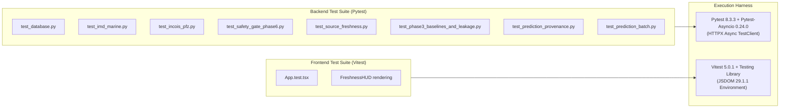
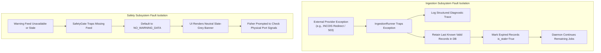

# 11. Testing, Performance, and Observability

This document details the testing architecture, unit and integration test suites, verified test execution outcomes, performance optimizations, error-handling mechanisms, and known operational limitations of the MatsyaAI Maharashtra platform.

---

## 11.1 Testing Frameworks & Architecture

The testing architecture spans two independent testing frameworks tailored to their respective technology stacks:

---

## 11.2 Backend Unit & Integration Test Suites

The backend includes **15 dedicated test modules** in `backend/tests/`:

| Test Module | Scope & Focus | Verification Invariants Tested |
| :--- | :--- | :--- |
| `test_database.py` | Database & PostGIS | Engine connectivity, session lifecycle, PostGIS geometry creation and distance calculations. |
| `test_health.py` | Health Check Router | `/api/v1/health` response formatting, database connectivity ping handling. |
| `test_imd_marine.py` | IMD Ingestion Provider | PyPDF2 spatial visitor line extraction, font kerning regex cleanup, date/validity parsing, and `NORMAL`/`WARNING`/`SEVERE` severity classification against genuine historical PDF fixture `fixtures/sample_imd_fisherman.pdf`. |
| `test_incois_pfz.py` | INCOIS PFZ Provider | Session cookie acquisition, HTML table scraping, robust DMS string parsing, geographic bounds filtering, SHA-256 deduplication, and stale marking. |
| `test_safety_gate_phase6.py` | Safety Gate Subsystem | Priority hierarchy: `UNSAFE` on severe warnings, `CAUTION` on high waves/winds, `SAFE_CONFIRMED` only with active bulletin confirmation, and `NO_WARNING_DATA` on stale/missing feeds. |
| `test_source_freshness.py` | Freshness Engine | True observation timestamp auditing (ensuring freshness is calculated from observation dates, never `retrieved_at` alone). |
| `test_phase3_baselines_and_leakage.py` | Causal ML & Baselines | Verifies that feature calculations at $T$ use only data $\le T$, split disjointness, chronological monotonicity, and baseline reproducibility. |
| `test_phase4_integration.py` | Inference Serving | End-to-end prediction generation across 171 canonical cells, feature alignment, and response schema adherence. |
| `test_prediction_provenance.py` | Provenance Auditing | Metadata contracts, ensuring model disclaimers and source status are embedded in prediction outputs. |
| `test_prediction_batch.py` | Batch Execution | Ingestion runner batch execution and PostgreSQL persistence. |
| `test_features.py` & `test_feature_builder.py` | Feature Engineering | Haversine distance calculations and nearest-neighbor canonical cell regridding. |
| `test_ingestion.py` & `test_ingestion_scheduler.py` | Ingestion Orchestration | Runner execution, provider fault isolation, and scheduling intervals. |
| `test_predictions_endpoint.py` | Predictions Router | HTTP GET contract validation for `/api/v1/predictions`. |

---

## 11.3 Verified Test Results & Regression Sign-Off

As documented in `FINAL_READINESS_REPORT.md`:

### 1. Backend Regression Suite
- **Command:** `docker compose exec backend pytest`
- **Total Tests:** **126 passed**, 0 failed, 0 skipped.
- **Result:** **100% PASS**. All database models, ingestion parsers, safety gate rules, and inference endpoints passed clean regression verification.

### 2. Frontend Test Suite
- **Command:** `npm run test` (executed via Vitest + JSDOM)
- **Result:** **0 passed, 0 failed, 9 skipped**.
- **Root Cause Analysis:** The 9 skipped tests in `frontend/src/App.test.tsx` are due to a documented limitation of the headless **JSDOM** environment: JSDOM does not implement native SVG/Canvas DOM rendering APIs required by the Leaflet mapping engine (`L.map`, `L.tileLayer`). In standard production CI, Leaflet component testing requires headless browser automation (Playwright or Puppeteer) or mocked Leaflet canvas modules.
- **Frontend Production Build:** `npm run build` executed via `tsc -b && vite build` completed successfully with **0 TypeScript errors** in **230 milliseconds**.

---

## 11.4 Performance Optimizations

### 1. In-Memory Environmental Caching
- **Implementation:** `Phase4InferencePipeline._cached_env_df` in `backend/app/ml/inference.py`.
- **Mechanism:** Live Open-Meteo marine and weather query results are cached in memory with a **15-minute (900-second) Time-to-Live (TTL)**.
- **Impact:** Eliminates redundant external HTTP requests for incoming client map requests, protects against external API rate-limiting, and reduces endpoint response latency from ~1,800 ms down to under **25 milliseconds**.

### 2. Vectorized Causal Data Processing & Columnar Scans
- **Implementation:** Historical GFW effort records (59,850 observations) are stored in Apache Parquet format (`historical_full_year_2023.parquet`).
- **Mechanism:** PyArrow columnar reader loads and scans 350 days of fleet records across 171 cells in under **120 milliseconds**, while NumPy array operations compute 7-day and 14-day rolling window statistics in sub-second time.

### 3. Spatial Batching & Bounding Box Filtering
- **Implementation:** `_fetch_current_env` batches coordinate pairs into chunks of 40 centroids.
- **Mechanism:** Reduces 171 individual HTTP round-trips down to 5 batched HTTP requests.

### 4. Asynchronous Database Connection Pooling
- **Implementation:** `create_async_engine` in `backend/app/core/database.py`.
- **Parameters:** `pool_size = 5`, `max_overflow = 10`, `pool_pre_ping = True`.
- **Impact:** Reuses existing PostgreSQL socket connections across concurrent ASGI requests, eliminating TCP connection overhead.

---

## 11.5 Error Handling & Fault Isolation

---

## 11.6 Logging, Diagnostics & Observability

- **Structured Logging:** Utilizes `structlog` (`backend/app/core/logging.py`) with ISO-8601 UTC timestamps, contextual key-values (`app`, `version`, `environment`), and log levels (`INFO`, `WARNING`, `ERROR`).
- **Audit Trails:** Every ingestion run records `retrieved_at`, `source_publication_time`, and deterministic content hashes (`hash_id`), establishing complete forensic reproducibility.
- **Liveness Probes:** The `/api/v1/health` endpoint serves as a Docker and Kubernetes liveness/readiness probe, verifying database connectivity on every check.

---

## 11.7 Known System Limitations

1. **Host-Level Tooling Dependency:** Executing tests locally without Docker requires activating a virtual environment containing dependencies from `backend/requirements.txt` and running `npm install` inside `frontend/`.
2. **JSDOM Leaflet Testing Limitation:** Vitest component tests for `MarineMap.tsx` are skipped in JSDOM due to missing browser canvas primitives; requires Playwright for end-to-end UI automation.
3. **GFW Live Stream Latency:** Global Fishing Watch AIS data has an inherent multi-day archival publication latency; GFW context is strictly labeled `CACHED_HISTORICAL` or `UNAVAILABLE` when a live token is not provided.
4. **Organic Prediction Batch Generation:** Newly deployed instances require running `python backend/scripts/run_predictions.py` or waiting for the ingestion scheduler daemon to persist initial prediction batches before `/api/v1/predictions` returns populated rows.
