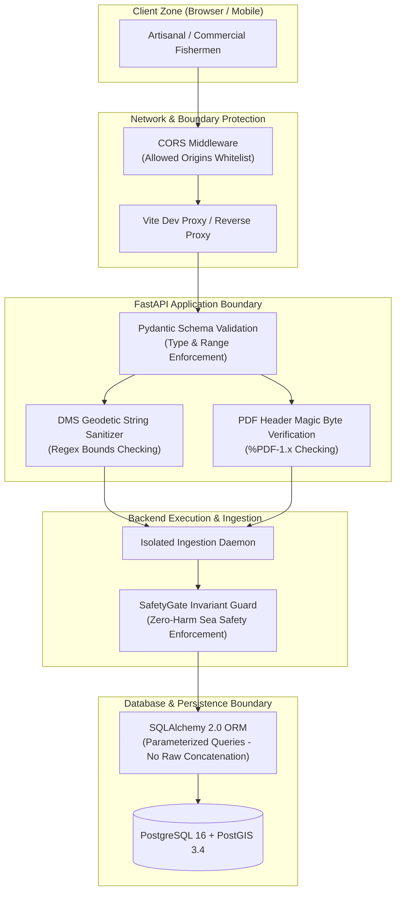

# 9. Security Analysis

This document provides a comprehensive security review of the MatsyaAI Maharashtra codebase, evaluating authentication mechanisms, authorization boundaries, input sanitization, data protection, secret handling, and vulnerability mitigations.

---

## 9.1 Security Architecture Overview



---

## 9.2 Authentication & Authorization Analysis

### Public Access Architecture (Zero-Friction for Fishers)
- **Design Decision:** The fisherman-facing endpoints (`/api/v1/map/summary`, `/api/v1/health`, `/api/v1/pfz/latest`, `/api/v1/predictions/latest`, `/api/v1/sources/freshness`) require **no end-user authentication or login wall**.
- **Security & Domain Rationale:** Fishermen operating from remote jetties or coastal villages at 04:30 IST often have basic smartphones, spotty 2G/3G connectivity, and low digital literacy. Enforcing authentication (JWT, OAuth, passwords) would create a catastrophic operational barrier during maritime emergencies. The application serves public government advisories and open predictive analytics that carry zero personally identifiable information (PII).

### Upstream Service Authentication & Credentials
- **Global Fishing Watch (GFW):** Protected via HTTP Bearer token authentication (`Authorization: Bearer <GFW_API_TOKEN>`). If the token is missing or expired, the backend automatically flags the provider as `UNAVAILABLE` without crashing or blocking the platform.
- **INCOIS TextData System:** Utilizes stateful HTTP session management. The provider dynamically requests a `JSESSIONID` cookie from `TextDataHome` and attaches it to subsequent requests.
- **Copernicus Marine Service (CMEMS):** Evaluated using environment-injected credentials (`COPERNICUS_MARINE_SERVICE_USERNAME`, `COPERNICUS_MARINE_SERVICE_PASSWORD`).
- **India Meteorological Department (IMD):** Ingests public bulletin PDFs via HTTPS without requiring API keys.

---

## 9.3 Input Validation & Defensive Data Ingestion

### 1. Pydantic Runtime Validation
- All incoming and outgoing data payloads are strictly validated against Pydantic schemas (`BaseModel` subclasses in `backend/app/schemas/` and `backend/app/api/v1/`).
- Prevents mass-assignment vulnerabilities, validates types, and rejects malformed payloads before execution reaches business logic.

### 2. DMS Geodetic Sanitization
- In `backend/app/services/ingestion/incois_pfz_provider.py` (`parse_dms`):
  - Strips non-alphanumeric and unexpected punctuation using regular expressions (`re.sub(r'[^0-9NSEWnsew\. ]', ' ', clean_str)`).
  - Enforces strict numeric ranges: Latitude must lie within $[-90.0, 90.0]$, Longitude within $[-180.0, 180.0]$.
  - Enforces Maharashtra coastal regional bounding box filters: Latitude $[10.0, 25.0]$, Longitude $[65.0, 80.0]$ to reject anomalous scraping errors.

### 3. PDF Ingestion Magic Byte Validation
- In `backend/app/services/ingestion/imd_marine_provider.py` (`_fetch_pdf_with_retry`):
  - Before parsing downloaded bytes, checks for PDF magic bytes:
    ```python
    if not content.startswith(b"%PDF"):
        raise ValueError("Downloaded content is not a valid PDF document.")
    ```
  - Prevents MIME-type confusion or server error HTML pages from being fed into the PDF deserializer.

---

## 9.4 Data Protection & SQL Injection Immunity

### Complete ORM Parameterization
- Across the entire backend codebase, **zero raw SQL string concatenation or f-string queries exist**.
- All database interactions use SQLAlchemy 2.0 type-safe expressions (`select()`, `update()`, `func.count()`) executed via `AsyncSession`.
- All query parameters (e.g., cell IDs, timestamps, hash digests) are bound using PostgreSQL binary parameter placeholders (`$1`, `$2`), rendering SQL injection attacks virtually impossible.

### Cross-Origin Resource Sharing (CORS) Protection
- Configured in `backend/app/main.py` via `CORSMiddleware`:
  ```python
  app.add_middleware(
      CORSMiddleware,
      allow_origins=settings.CORS_ORIGINS,
      allow_credentials=True,
      allow_methods=["*"],
      allow_headers=["*"],
  )
  ```
- Defaults to strictly whitelisted frontend hosts (`http://localhost:5173`, `http://localhost:3000`), preventing unauthorized cross-origin browser requests from external domains.

---

## 9.5 Environment Variable & Secret Management

- **No Hardcoded Credentials:** The repository adheres strictly to 12-Factor App principles. Passwords, connection strings, and API keys are loaded exclusively from environment variables or a local `.env` file via `pydantic-settings`.
- **Git Protection:** `.gitignore` explicitly excludes `.env`, `*.joblib`, raw data dumps, and credentials:
  ```gitignore
  .env
  .env.*
  *.pem
  *.key
  ```
- **Template Safety:** `.env.example` provides empty placeholders and non-sensitive local defaults (`matsya:matsya_dev@db:5432/matsya_ai`).
- **Safe Degradation:** If external API tokens (`GFW_API_TOKEN`, `IMD_API_KEY`) are omitted, the application logs a clean warning and degrades gracefully to `UNAVAILABLE` or `DEMO_MODE` without exposing stack traces or crashing.

---

## 9.6 Vulnerability & Threat Assessment (OWASP Top 10 Evaluation)

| OWASP Threat Category | Risk Level in MatsyaAI | Technical Assessment & Mitigation |
| :--- | :--- | :--- |
| **A01: Broken Access Control** | Low | All endpoints are intentionally public read-only; database mutations are restricted to internal backend processes and daemons. |
| **A02: Cryptographic Failures** | Low | Internal services communicate over private Docker bridge networks; external integrations use HTTPS (TLS 1.2/1.3); deduplication uses cryptographically secure SHA-256. |
| **A03: Injection (SQL / Command)** | Very Low | Full SQLAlchemy 2.0 ORM parameterization; no shell command execution within request lifecycles. |
| **A04: Insecure Design (Safety)** | **Mitigated** | Traditional risk: ML predicting "safe to fish" in a cyclone. **Mitigated by Design:** `SafetyGate` completely decouples ML from safety decisions; absence of warning data defaults to `NO_WARNING_DATA`. |
| **A05: Security Misconfiguration** | Low | Docker Compose limits database exposure to standard ports; detailed debug stack traces are restricted to development mode. |
| **A06: Vulnerable Dependencies** | Low | Dependencies pinned to modern, active releases (FastAPI 0.115, Pydantic 2.9, SQLAlchemy 2.0, Vite 8, Leaflet 1.9). |
| **A07: Identification & Auth Failures** | N/A | Public application by design; no user credential storage or session hijacking vectors. |
| **A08: Software & Data Integrity Failures** | Low | Model artifacts (`.joblib`, `.json`) are stored locally within the application package and loaded using trusted local paths. |
| **A09: Security Logging & Monitoring** | Low | Implements structured key-value logging (`structlog`), tracking startup, shutdown, provider failures, and deduplication events. |
| **A10: Server-Side Request Forgery (SSRF)** | Low | All outbound HTTP requests target hardcoded, immutable authoritative URLs (`IMD_MUMBAI_FISHERMAN_PDF_URL`, `TEXT_DATA_MAHARASHTRA_URL`). User input never controls outbound URLs. |

---

## 9.7 Denial of Service (DoS) & Upstream Outage Protection

1. **Request Timeouts:** All external HTTP requests executed via `httpx` and `urllib` enforce explicit timeouts (`REQUEST_TIMEOUT_SECONDS = 30` or `10s`). No outbound request can hang worker threads indefinitely.
2. **In-Memory Caching:** Open-Meteo marine and weather queries are cached in memory for 15 minutes (`900` seconds). High volumes of client map requests do not cause external API quota exhaustion or IP bans.
3. **Database Connection Pooling:** PostgreSQL connection pool limits (`pool_size=5`, `max_overflow=10`) prevent connection exhaustion attacks on the database engine.
4. **Resilient Retry Backoff:** Failed external calls execute exponential backoff ($2, 4, 8$ seconds) up to a maximum of 3 retries, preventing self-inflicted denial-of-service on government portals.
